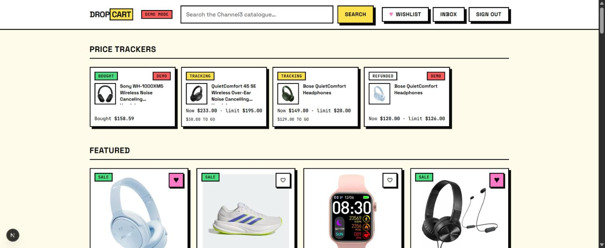
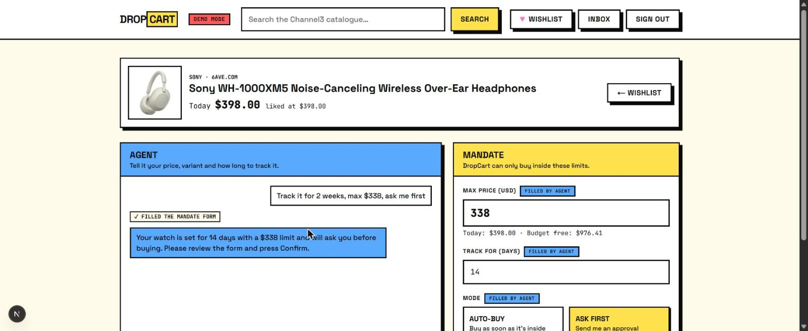
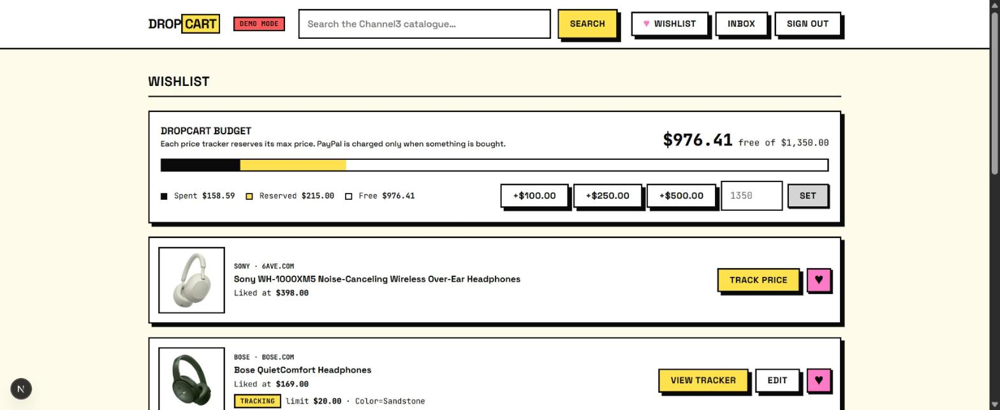
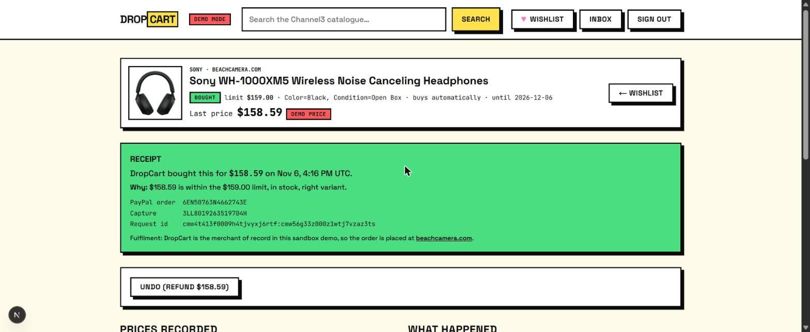
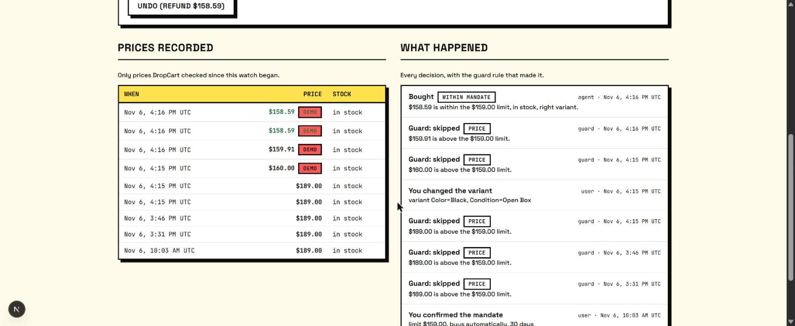
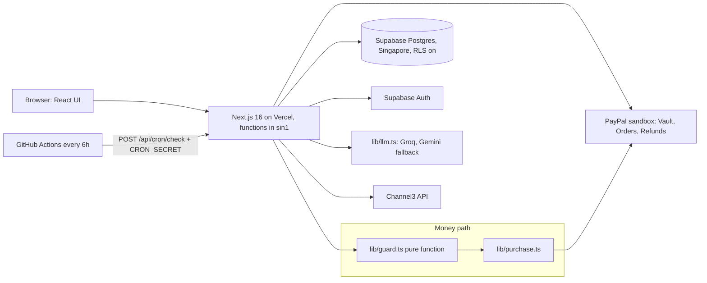
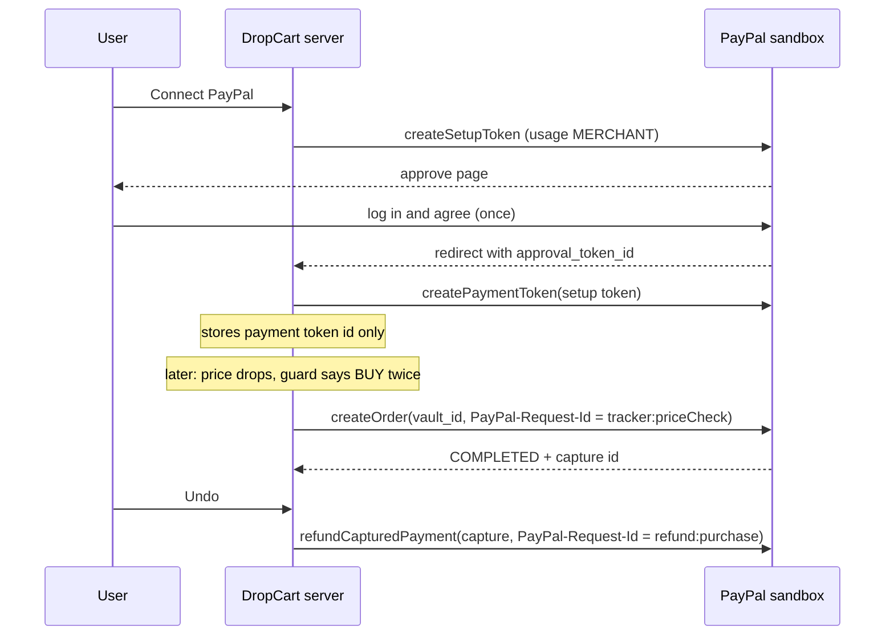
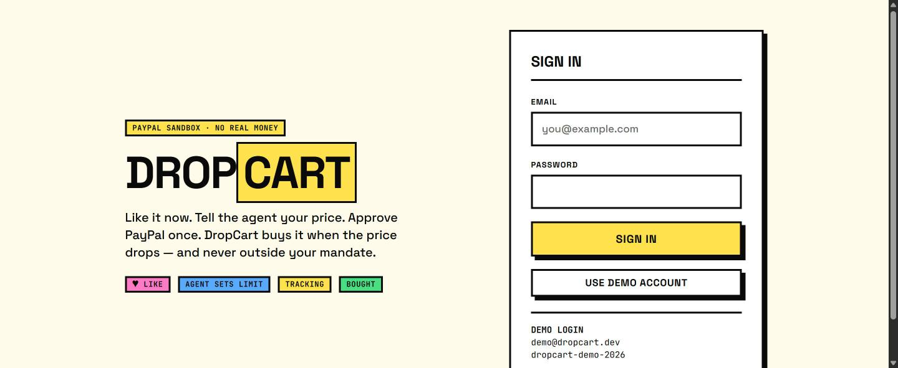

# DropCart

**Like it now, tell an AI agent your price, approve PayPal once. DropCart buys it when the price drops, and only inside the mandate you approved.**

- **Live demo:** https://drop-cart-tan.vercel.app (sign in with **Use demo account**)
- **Demo video:** _TODO (Day 6: YouTube link, under 3 min)_
- **Repository:** https://github.com/KartikMantri/DropCart

> Built for the PayPal AI Hackathon 2026. **Sandbox money only.** No real payments are ever made.



---

## Contents

- [The problem](#the-problem)
- [What it does](#what-it-does)
- [How it works](#how-it-works)
- [Sponsor tools used](#sponsor-tools-used): [PayPal](#paypal-core), [Channel3](#channel3), [APIMatic ContextMatic](#apimatic-contextmatic)
- [AI used](#ai-used)
- [Security](#security)
- [Run it locally](#run-it-locally) · [Deploy](#deploy)
- [Test logins](#test-logins) · [Demo mode](#demo-mode)
- [Scope and limits](#scope-and-limits) · [Built during the hackathon](#built-during-the-hackathon)

## The problem

Price alerts arrive when you can't act on them. By the time you open the email, the deal is gone. The obvious fix is to let an agent buy for you, but people don't trust an AI with their money, and they're right not to: an LLM can hallucinate, misread a variant, or get talked into something.

DropCart lets an agent buy for you, but **the agent never touches money**. It only fills in a form. You confirm a *mandate* (max price, variant, how long, auto-buy or ask first), and a small, fully tested, deterministic guard decides every purchase.

## What it does

1. **Browse** the Channel3 product catalogue and search all of it.
2. **Like** products to save them to your wishlist.
3. **Tell the agent your limit**, for example *"Track it for 2 weeks, max $338, ask me first."* The agent fills in the mandate form; every field it filled is tagged **Filled by agent**. You review, edit and confirm.

   

4. **Approve PayPal once.** A PayPal Vault consent (sandbox) saves PayPal as your payment method. DropCart stores only the token id.
5. **Stay inside your DropCart Budget.** Each price tracker reserves its max price from a budget you set. No money is held: PayPal is charged only when something is bought. A tracker that doesn't fit is refused with a clear message.

   

6. **Auto-buy inside the mandate.** DropCart re-checks prices every 6 hours. When the live price is at or under your limit, for the right variant and in stock, it captures the PayPal payment and shows a receipt explaining why it bought.

   

7. **See every decision.** Each tracker shows the prices DropCart recorded and every guard decision with the rule that made it. Here it skipped at $160.00 and $159.91, just over a $159 limit, then bought at $158.59.

   

8. **Undo.** One tap issues a full PayPal refund.

## How it works

> **The LLM never moves money.** It can search, explain, and draft or edit a mandate. A PayPal capture happens only in `lib/purchase.ts`, only after the pure guard in `lib/guard.ts` returns `BUY` twice: on the scheduled check and again on a fresh live re-check right before payment.



**One purchase, step by step** (`lib/checks.ts` → `lib/purchase.ts`):

1. **Live quote:** get the live price, stock and resolved variant from Channel3 and record a `PriceCheck`.
2. **Guard, scheduled check:** anything but BUY is recorded and stops here.
3. **PayPal connected?** If not, the tracker waits for the user.
4. **Claim:** atomically move the tracker `ACTIVE → PURCHASING`. A second concurrent run stops here.
5. **Fresh re-check:** a new live quote, then the guard again.
6. **Charge** the vaulted PayPal wallet with `PayPal-Request-Id = ${trackerId}:${priceCheckId}`. `lib/paypal.ts` also refuses any amount above the mandate limit, as a last independent check.
7. **Record:** receipt, budget, audit log and notification. On failure, nothing is charged and the tracker keeps tracking.

### Guard rules (`lib/guard.ts`)

The guard is a pure function (no I/O, no clock reads) with unit tests covering every branch. Rules apply in order, and the first match wins:

| # | Rule | Decision |
|---|---|---|
| 1 | Price tracker isn't `ACTIVE` | SKIP (inactive) |
| 2 | Mandate has expired | EXPIRE |
| 3 | Channel3 has no offer for the product | SKIP (unavailable) |
| 4 | Live product ≠ tracked product | SKIP (mismatch) |
| 5 | Live variant ≠ tracked variant | SKIP (variant) |
| 6 | Price currency ≠ mandate currency | SKIP (currency) |
| 7 | Store not in the allowed list (empty list = any store) | SKIP (merchant) |
| 8 | Out of stock | SKIP (stock) |
| 9 | No price, or price > mandate max | SKIP (price) |
| 10 | Spent + price > DropCart Budget (safety net; each tracker already reserves its limit) | ASK (budget) |
| 11 | Mandate mode is `ASK_FIRST` | ASK (mode) |
| 12 | Limit was just raised to or above today's price | ASK (would buy now) |
| — | Otherwise | **BUY** |

Every decision writes an `AuditLog` row. An ASK sends an in-app notification, and the user answers with **Buy it** or **Not now**. Approving turns an ASK into a BUY, but never overrides a SKIP.

### DropCart Budget

A **spending cap**, not a wallet: no money is ever held.

```
available = budget − spent (captured, not refunded) − reserved (max price of every open tracker)
```

- **New tracker:** creating one reserves its limit. Two trackers created at the same moment can't both take the last dollars, because the reservation runs under a row lock on the user.
- **Buying under the limit** frees the difference. A $126 reservation bought at $120 returns $6 to available.
- **Refunds and endings:** a refund, an expired mandate or a stopped tracker releases the money.
- **Lowering the budget:** it can't go below spent + reserved.

## Sponsor tools used

### PayPal (core)

Sandbox only: `lib/env.ts` refuses any `PAYPAL_ENV` other than `sandbox`. All PayPal calls live in **`lib/paypal.ts`**, which uses the official **`@paypal/paypal-server-sdk` 2.5.0**. DropCart stores only PayPal token ids, never card or wallet details.

| API | What DropCart does with it | Where |
|---|---|---|
| **Vault v3: setup token** | "Connect PayPal": a PayPal-wallet setup token with `usage_type: MERCHANT`, approved once by the user | `createVaultSetupToken`, `/api/paypal/vault/start` |
| **Vault v3: payment token** | Exchanges the approved setup token for a reusable payment token, stored on the user | `exchangeSetupToken`, `/api/paypal/vault/return` |
| **Orders v2: create + capture** | Merchant-initiated charge with no buyer present (`vault_id`, `stored_credential.payment_initiator: MERCHANT`) | `chargeVaultedPayment`, called only from `lib/purchase.ts` |
| **Payments v2: refund** | "Undo": a full refund of the capture | `refundCapture`, `/api/purchases/[id]/refund` |



**Making payments safe:**
- **Idempotency everywhere.** Each purchase uses `PayPal-Request-Id = ${trackerId}:${priceCheckId}`, a refund uses `refund:${purchaseId}`, and the vault exchange uses `vault:${setupTokenId}`. A retry returns the original result instead of charging twice.
- **The vault return is bound to its browser.** An httpOnly cookie means `/vault/return` only accepts the setup token that this browser started.
- **Hard cap.** `chargeVaultedPayment` throws `OVER_MANDATE` before calling PayPal if the amount exceeds the mandate limit.
- **No blind retries.** A tracker stuck mid-purchase after a crash is paused for the user, never retried, so an unknown PayPal state can't become a double charge.

**Verified live in the sandbox** (`npm run test:paypal -- --saved`, and the demo flow in the browser):
- A vault-id order is captured on create (status `COMPLETED`).
- Repeating the call with the same `PayPal-Request-Id` returns the same order and capture.
- The refund completes.

**Sandbox setup notes:** Vault v3 requires a **US** sandbox *business* account, and **Save payment methods** enabled on the REST app. With an Indian business account, setup tokens return `403 NOT_AUTHORIZED`.

### Channel3

Every product a user sees, and every price behind every buy decision, comes from **Channel3** through its official **`@channel3/sdk` 4.8.0**. All calls go through **`lib/channel3.ts`**; the rest of the app only sees DropCart's own types.

| Use | Where | Channel3 call |
|---|---|---|
| Home **Featured** grid (headphones, running shoes, smart watches) | `/api/catalogue/featured` → `getFeatured()` | `products.search` (3 category searches) |
| Full-catalogue **search** | `/search`, `/api/catalogue/search` → `searchProducts()` | `products.search` |
| **Agent tools** `search_products`, `get_product`, `list_variants` | `lib/agent-tools.ts` | `products.search`, `products.retrieve` |
| Mandate **variant validation** and today's price | `lib/watches.ts` | `products.retrieve` with `selected_options` |
| **Live price and stock re-checks** that feed the guard | `lib/checks.ts` → `getLiveQuote()` | `products.retrieve` with `selected_options` |

**Staying inside the free tier (1,000 searches a month):**
- Search runs on submit only, never per keystroke.
- Identical queries are cached for 1 hour in the `CatalogueCache` table.
- The featured grid is cached for 24 hours: about 90 searches a month.
- Concurrent identical requests are de-duplicated. If Channel3 is briefly unavailable, the grid serves its stale cache.
- Price re-checks use `products.retrieve` (`GET /v1/products/{id}`), which is **free** and doesn't count against the search quota. That's why checking every tracker every 6 hours costs nothing.

**Variants done right:** some product families model a colour as a separate Channel3 product. DropCart asks for the watched variant via `selected_options`, stores that variant's own product id on the tracker, and compares the variant Channel3 *actually resolved*. If Channel3 quietly substitutes another colour (the black one sold out), the guard skips instead of buying the wrong thing.

**Merchant of record:** Channel3 products link to third-party stores, which a PayPal sandbox can't pay. DropCart acts as the merchant: it charges the user through PayPal, and the receipt links to the store for fulfilment.

### APIMatic ContextMatic

**All PayPal code in `lib/paypal.ts` was written with the APIMatic ContextMatic plugin** active in the coding agent (Claude Code). ContextMatic is an MCP server that serves version-aware context for the real PayPal Server SDK: method names, request and response models, and code samples. The agent works from that context instead of whatever it remembers from training.

**Install** (Claude Code CLI 2.1.92 or later):

```bash
claude plugin marketplace add apimatic/context-matic
claude plugin install context-matic@apimatic --scope user
# then /reload-plugins inside Claude Code
```

**How it was used:**

| Tool | Used for |
|---|---|
| `fetch_api` | Found the PayPal Server SDK for TypeScript (`key: paypal`) |
| `ask` | One question per integration: Vault setup token → payment token, Orders create + capture with a vault id and `PayPal-Request-Id`, full refunds, and a sandbox 403 |
| `endpoint_search` | `createSetupToken` parameters, e.g. that `paypalRequestId` exists and how long keys are stored |
| `model_search` | `PaypalWalletStoredCredential`, to check which fields a PayPal-wallet stored credential really has |
| `update_activity` | Recorded the integration milestones (first call, error found, error resolved) |

**What it got right:**
- Every method name, parameter name and response path matched SDK 2.5.0, e.g. `VaultController.createSetupToken`, `OrdersController.createOrder({ paypalRequestId, prefer, body })`, the capture at `purchaseUnits[0].payments.captures[0]`, and `PaymentsController.refundCapturedPayment`.
- It recommended the current `@paypal/paypal-server-sdk`, not the deprecated `paypal-rest-sdk`.
- It said plainly when its sources didn't cover something, such as whether vault-id orders auto-capture, or which sandbox permission was missing, instead of guessing.

**Where it needed checking:**
- **Enums:** `tsc` flagged two string literals (`'MERCHANT'`, `'SETUP_TOKEN'`) where SDK 2.5.0 requires enums (`PaypalPaymentTokenUsageType.Merchant`, `VaultTokenRequestType.SetupToken`).
- **A field from the wrong model:** the Orders sample put `paymentType` on a PayPal-wallet stored credential. `model_search` showed that field exists only on `CardStoredCredential`, so it was removed.
- **Open questions settled in the sandbox:** vault-id orders do auto-capture (`COMPLETED` on create), and the `captureOrder` fallback stays as a safety net. The 403 turned out to be a non-US sandbox business account.

The full prompt-by-prompt log is in [`docs/contextmatic.md`](docs/contextmatic.md).

## AI used

- **Primary:** Groq, model `openai/gpt-oss-120b` (override with `GROQ_MODEL`).
- **Fallback:** Google Gemini Flash, model `gemini-3.8-flash` (override with `GEMINI_MODEL`).

Both are called through `lib/llm.ts`, which exposes a single AI SDK model. That model tries Groq first and switches to Gemini on HTTP 429 (rate limit) or any other error. The fallback is unit-tested in `tests/llm.test.ts`.

**The agent can:** search the catalogue, look up a product's current price, stock and variants, and fill in or edit a mandate form. It knows the user's free budget and the current mandate when editing.

**The agent cannot:** capture, authorize or refund payments, confirm a mandate on your behalf, or claim a purchase happened unless the server reports it. It has no tool that can do any of these.

## Security

- **Server-only secrets.** PayPal, Channel3, LLM and database code is marked `import "server-only"`, so the build fails if it's ever pulled into browser code. Only the Supabase URL and anon key are public.
- **Row Level Security on every table.** The app reaches the database only through server-side Prisma (as the table owner), so Supabase's auto-generated REST API is closed: RLS is on, there are no policies, and the API roles' grants are revoked. Migration `20261106200000_enable_rls`.
- **Scheduler secret.** `/api/cron/check` requires `Authorization: Bearer $CRON_SECRET`, compared in constant time.
- **Ownership checks.** Every tracker, purchase and refund action checks that it belongs to the signed-in user.
- **Open redirects blocked.** Only same-site relative paths are accepted after login and PayPal.

## Run it locally

**Prerequisites:** Node.js 20 or later, a free Supabase project, a PayPal developer account with a **US** sandbox business account, and free API keys (see the table below).

```bash
git clone https://github.com/KartikMantri/DropCart.git
cd DropCart
npm install                   # also runs `prisma generate`
cp .env.example .env.local    # fill in the values below
npx prisma migrate deploy     # tables, budget column, RLS
npx prisma db seed            # demo user, liked items, one active price tracker
npm run dev                   # http://localhost:3000
```

| Variable | What it is | Where to get it (free) |
|---|---|---|
| `DATABASE_URL` | Pooled Postgres URL (port 6543, `?pgbouncer=true`), used at runtime | Supabase → Project Settings → Database |
| `DIRECT_URL` | Direct/session Postgres URL (port 5432), used for migrations | Supabase → Project Settings → Database |
| `NEXT_PUBLIC_SUPABASE_URL` | Supabase project URL | Supabase → Project Settings → API |
| `NEXT_PUBLIC_SUPABASE_ANON_KEY` | Public anon key | Supabase → Project Settings → API |
| `SUPABASE_SERVICE_ROLE_KEY` | Server-only admin key, used by the seed script to create the demo user | Supabase → Project Settings → API |
| `GROQ_API_KEY` | Primary LLM | [console.groq.com/keys](https://console.groq.com/keys) |
| `GEMINI_API_KEY` | Fallback LLM | [aistudio.google.com/apikey](https://aistudio.google.com/apikey) |
| `CHANNEL3_API_KEY` | Product catalogue | [trychannel3.com](https://trychannel3.com) dashboard |
| `PAYPAL_CLIENT_ID` / `PAYPAL_CLIENT_SECRET` | Sandbox REST app on a **US** business account, with **Save payment methods** on | [developer.paypal.com](https://developer.paypal.com) → Apps & Credentials → Sandbox |
| `PAYPAL_ENV` | Must be `sandbox` | — |
| `CRON_SECRET` | Bearer token for `/api/cron/check` (at least 16 characters) | `node -e "console.log(require('crypto').randomBytes(32).toString('hex'))"` |
| `DEMO_MODE` | `true` enables "Check now" and "Drop & check" | — |

**Useful scripts:**
- `npm test`: 108 unit tests (guard, budget, purchase flow, checks, mandate edits, cron auth, PayPal hard cap, vault helpers, LLM fallback).
- `npm run test:paypal`: live PayPal sandbox smoke test. Add `-- --saved` to charge and refund $1 on the token saved by Connect PayPal.
- `npm run test:channel3` / `npm run test:llm`: live Channel3, Groq and Gemini smoke tests.
- `npx tsx --conditions=react-server scripts/watch-report.ts`: read-only view of budgets and price trackers.
- `npx tsx --conditions=react-server scripts/check-watch.ts --all`: run the scheduled check now.
- `npx tsx --conditions=react-server scripts/reset-demo.ts`: preview a reset of the demo account; add `--yes` to apply it.

## Deploy

The app runs on **Vercel**. `vercel.json` pins functions to `sin1`, next to the Supabase project in Singapore.

1. **Import the project:** import the repository in Vercel and paste the environment variables above. Mark the secrets as *Sensitive*.
2. **Point Supabase at the site:** under Authentication → URL Configuration, set **Site URL** to the Vercel URL and add `https://<app>/**` to Redirect URLs.
3. **Add the scheduler secrets:** in GitHub → Settings → Secrets → Actions, add `DROPCART_URL` (the Vercel URL, no trailing slash) and `CRON_SECRET` (the same value as in Vercel).
4. **Check it works:** run **Actions → Price checks → Run workflow**. A good run prints `{"checked":…}`, and the workflow fails on a 401 or a redirect. `GET /api/health` reports whether the app and database are up.

The scheduler is a GitHub Actions workflow (`.github/workflows/price-checks.yml`, every 6 hours) because Vercel's free plan only runs cron jobs once a day.

## Test logins

| Account | Email | Password |
|---|---|---|
| DropCart demo app account | `demo@dropcart.dev` | `dropcart-demo-2026` |



The demo account already has PayPal (sandbox) connected, so **Drop & check** works straight away. These are sandbox and demo credentials only. No real money is ever involved.

## Demo mode

With `DEMO_MODE=true` (on in the live demo, shown by a red **DEMO MODE** badge), each price tracker page gets:
- **Check now:** runs a real price check immediately instead of waiting for the 6-hour schedule.
- **Drop & check** (`POST /api/demo/price-override`): pretends the live price is a given amount, so the full drop → guard → PayPal capture → receipt flow can be shown on demand.
  - Stock and variant stay real.
  - The override also applies to the re-check right before payment.
  - The guard still applies every rule.
  - Checks made with an override are stored with `isDemo = true` and marked **Demo** in the price history.

**Try it:** Use demo account → **Wishlist** → **View tracker** → enter a price under the limit → **Drop & check** → receipt → **Undo**.

## Scope and limits

- **Sandbox money only.** No real payments.
- **USD only.**
- **Merchant of record.** DropCart charges through PayPal and links to the store for fulfilment (see [Channel3](#channel3)).
- **Accounts.** Sign-in is email and password. The demo account is created by the seed script.
- **Notifications** are in-app (Inbox).
- **Price history** shows only prices DropCart recorded since the tracker began.
- **Channel3 free quota** of 1,000 searches a month, kept in budget by the caching described above.

## Built during the hackathon

Started from scratch on Nov 6, 2026, within the hackathon window (after Oct 1, 2026).

- **Day 1:** Next.js 16 and Tailwind v4 scaffold with the neo-brutalism design tokens; Prisma 7 schema on Supabase Postgres with a seed script; Supabase email/password auth with a login page and demo account; `lib/llm.ts` (Groq → Gemini fallback, unit-tested); `lib/channel3.ts` (cached search, featured grid, free live quotes, variant resolution).
- **Day 2:** Home Featured grid (up to 50 products, cached) and the full-catalogue search page; heart button and wishlist; agent chat with Channel3 tools (`search_products`, `get_product`, `list_variants`, `draft_mandate`) beside a mandate form the agent fills in ("Filled by agent" tags). The user edits and confirms it, and the server checks the variant and today's price against Channel3 before creating the tracker.
- **Day 3:** PayPal Vault (setup token → payment token), merchant-initiated order + capture with `PayPal-Request-Id`, and refunds, all written with ContextMatic; `lib/purchase.ts` (guard twice, atomic claim, live re-check, hard cap); the guard with full branch coverage; the DropCart Budget (each tracker reserves its limit).
- **Day 4:** scheduled checks (`/api/cron/check` + GitHub Actions), demo-mode Check now and Drop & check, approvals (Buy it / Not now), pause/resume/stop, editing a mandate from chat (a raised limit must fit the budget), the tracker page (receipt, price history, decision log, Undo), the home Price trackers row and the Inbox.
- **Day 5:** deployed to Vercel (`sin1`) with a health check and the GitHub Actions scheduler (hardened to fail on redirects); Row Level Security on every table; "price tracker" wording throughout; a demo reset script; README with screenshots.

## Planned

- **Sign-up** for new users (today: the demo account, or accounts added in Supabase).
- **Email notifications** through Resend: bought, approval needed, refunded.
- **INR stores**, for Indian merchants and currency.
- **More payment methods** beyond PayPal Vault.

## License

[MIT](LICENSE)
