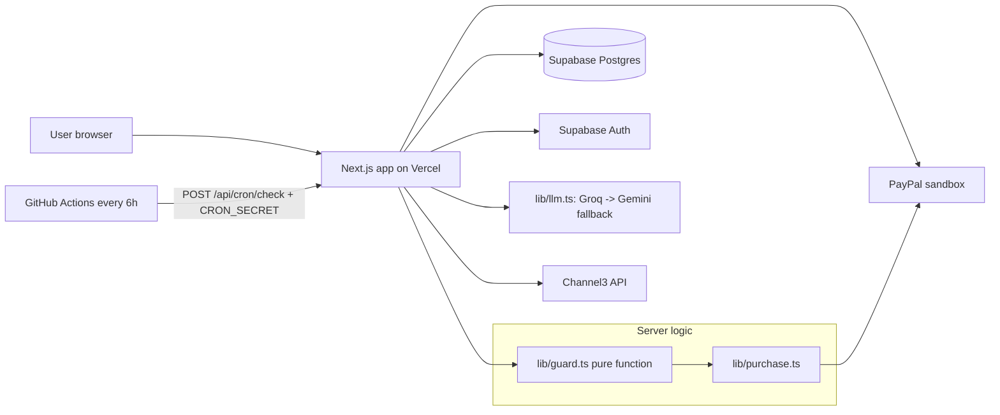

# DropCart

**Like it now, tell an AI agent your price, approve PayPal once. DropCart buys it when the price drops, and only inside the mandate you approved.**

- **Live demo:** _TODO (Day 5: Vercel URL)_
- **Demo video:** _TODO (Day 6: YouTube link, under 3 min)_

 <!-- TODO Day 5 -->

> Built for the PayPal AI Hackathon 2026. Sandbox money only.

---

## The problem

Price alerts arrive when you can't act on them. By the time you open the email, the deal is gone. The obvious fix is to let an agent buy for you, but people don't trust an AI with their money, and they're right not to: an LLM can hallucinate, misread a variant, or get talked into something.

## What it does

1. **Browse** the Channel3 product catalogue and search all of it.
2. **Like** products to save them to your wishlist.
3. **Tell the agent your limit**, for example *"Get it under $280, black, for 30 days."* The agent fills in a mandate form (max price, variant, expiry, mode), and you edit and confirm it.
4. **Approve PayPal once.** A sandbox Vault consent saves PayPal as your payment method.
5. **Auto-buy inside the mandate.** DropCart re-checks prices on a schedule. When the live price is under your limit, for the right variant and in stock, it captures the PayPal payment and shows a receipt explaining why it bought.
6. **Undo.** One tap issues a PayPal refund.

## How it works

> **The LLM never moves money.** It can search, explain, and draft or edit a mandate. A PayPal capture happens only in `lib/purchase.ts`, only after the pure guard function in `lib/guard.ts` returns `BUY`, and only after a fresh live price re-check passes the guard again.



### Guard rules (`lib/guard.ts`)

The guard is a pure function with unit tests covering every branch. It applies these rules in order, and the first match wins:

| # | Rule | Decision |
|---|---|---|
| 1 | Watch isn't `ACTIVE` | SKIP (inactive) |
| 2 | Mandate has expired | EXPIRE |
| 3 | Live product ≠ watched product | SKIP (mismatch) |
| 4 | Live variant ≠ watched variant | SKIP (variant) |
| 5 | Out of stock | SKIP (stock) |
| 6 | Price > mandate max | SKIP (price) |
| 7 | This month's spend + price > budget | ASK (budget) |
| 8 | Mandate mode is `ASK_FIRST` | ASK (mode) |
| 9 | Limit was just raised above today's price | ASK (would buy now) |
| — | Otherwise | **BUY** |

Every decision writes an `AuditLog` row. Every capture uses `PayPal-Request-Id = ${watchId}:${priceCheckId}`, so a retry can never double-charge.

## Sponsor tools used

### PayPal (core)

Sandbox only (`PAYPAL_ENV=sandbox`). DropCart stores only the PayPal vault payment token, never card data.

| API | Where |
|---|---|
| **Vault**: save PayPal as a payment method | `lib/paypal.ts`, `/api/paypal/vault/setup-token`, `/api/paypal/vault/payment-token` |
| **Orders**: create and capture against the vault token | `lib/purchase.ts` |
| **Refunds**: Undo | `/api/purchases/[id]/refund` |

_TODO (Day 3): confirm the final API list._

### Channel3

Every product a user sees, and every buy decision, comes from Channel3 data.

| Use | Where | Endpoint |
|---|---|---|
| Featured catalogue grid | `/api/catalogue/featured` → `getFeatured()` | `POST /v1/search` (3 category searches) |
| Full catalogue search | `/api/catalogue/search` → `searchProducts()` | `POST /v1/search` |
| Agent tools `search_products`, `get_product`, `list_variants` | `lib/agent-tools.ts` | search + `GET /v1/products/{id}` |
| Live price and stock re-checks that feed the guard | `/api/cron/check`, `lib/purchase.ts` → `getLiveQuote()` | `GET /v1/products/{id}` with `selected_options` |

All of these calls go through `lib/channel3.ts`.

**Staying inside the free tier (1,000 searches/month):**
- Search runs on submit only, never per keystroke.
- Identical queries are cached for 1 hour in the `CatalogueCache` table.
- The featured grid is cached for 24 hours, which comes to about 90 searches a month.
- Concurrent identical requests are de-duplicated.
- If Channel3 is briefly unavailable, the grid serves its stale cache.
- Price re-checks use the product-detail endpoint, which is **free** and doesn't count against the search quota. That's why checking every watch every 6 hours costs nothing.

**Variants:** some product families model a colour as a separate Channel3 product. DropCart stores the variant's own product ID on the watch and compares the variant Channel3 actually resolved, so a quietly substituted variant is skipped and never bought.

### APIMatic (ContextMatic)

**Built with ContextMatic.** _TODO (Day 3):_
- How it was installed in the coding agent.
- Which PayPal integrations it was used for (Vault, Orders, Refunds).
- 2–3 example prompts and what it got right, for example using `@paypal/paypal-server-sdk` instead of the deprecated `paypal-rest-sdk`.

The full log is in [`docs/contextmatic.md`](docs/contextmatic.md).

## AI used

- **Primary:** Groq, model `openai/gpt-oss-120b` (override with `GROQ_MODEL`).
- **Fallback:** Google Gemini Flash, model `gemini-2.5-flash` (override with `GEMINI_MODEL`).

Both are called through `lib/llm.ts`, which exposes a single AI SDK model. That model tries Groq first and switches to Gemini on HTTP 429 (rate limit) or any other error. The fallback is unit-tested in `tests/llm.test.ts`.

**The agent can:** search the catalogue, look up a product's current price, stock and variants, and draft or edit a mandate. Every draft has to be confirmed by the user in the form.

**The agent cannot:** capture, authorize or refund payments, confirm a mandate on your behalf, or claim a purchase happened unless the server reports it.

## Run it locally

**Prerequisites:** Node.js 20 or later, a free Supabase project, and free API keys (see the table below).

```bash
git clone https://github.com/KartikMantri/dropcart.git
cd dropcart
npm install            # also runs `prisma generate`
cp .env.example .env.local   # fill in the values below
npx prisma migrate deploy
npx prisma db seed     # demo user, liked items, one active watch
npm run dev            # http://localhost:3000
```

| Variable | What it is | Where to get it (free) |
|---|---|---|
| `DATABASE_URL` | Pooled Postgres URL (port 6543, `?pgbouncer=true`), used at runtime | Supabase → Project Settings → Database |
| `DIRECT_URL` | Direct/session Postgres URL (port 5432), used for migrations | Supabase → Project Settings → Database |
| `NEXT_PUBLIC_SUPABASE_URL` | Supabase project URL | Supabase → Project Settings → API |
| `NEXT_PUBLIC_SUPABASE_ANON_KEY` | Public anon key | Supabase → Project Settings → API |
| `SUPABASE_SERVICE_ROLE_KEY` | Server-only admin key, used by the seed script to create the demo user | Supabase → Project Settings → API |
| `GROQ_API_KEY` | Primary LLM | [console.groq.com/keys](https://console.groq.com/keys) |
| `GEMINI_API_KEY` | Fallback LLM | [aistudio.google.com/apikey](https://aistudio.google.com/apikey) |
| `CHANNEL3_API_KEY` | Product catalogue | [trychannel3.com](https://trychannel3.com) dashboard |
| `PAYPAL_CLIENT_ID` / `PAYPAL_CLIENT_SECRET` | Sandbox REST app credentials | [developer.paypal.com](https://developer.paypal.com) → Apps & Credentials → Sandbox |
| `PAYPAL_ENV` | Must be `sandbox` | — |
| `CRON_SECRET` | Bearer token for `/api/cron/check` | Any long random string |
| `DEMO_MODE` | `true` enables "Check now" and the price override | — |

Useful scripts:
- `npm test`: unit tests (guard, LLM fallback).
- `npm run test:channel3`: live Channel3 smoke test. Uses one search.
- `npm run test:llm`: live Groq and Gemini smoke test.

## Test logins

| Account | Email | Password |
|---|---|---|
| DropCart demo app account | `demo@dropcart.dev` | `dropcart-demo-2026` |
| PayPal sandbox buyer | _TODO (Day 3)_ | _TODO_ |

These are sandbox and demo credentials only. No real money is ever involved.

## Demo mode

With `DEMO_MODE=true`, each watch gets:
- **Check now**: runs a price check immediately instead of waiting for the 6-hourly schedule.
- **Price override** (`POST /api/demo/price-override`): sets a fake live price for one watch, then runs a check, so the full drop → BUY → capture → receipt flow can be shown on demand.

Whenever overrides are active, the UI shows a red **DEMO MODE** badge, and price checks made with an override are stored with `isDemo = true`.

## Scope and limits

- **Merchant of record.** Channel3 returns products that link to third-party stores, and a PayPal sandbox account can't pay those stores. So DropCart acts as the merchant: it charges the user through PayPal for the item, then shows the merchant link as the fulfilment step.
- **Sandbox money only.** No real payments.
- **USD only.**
- **Channel3 free quota.** 1,000 searches a month, kept in budget by the caching described above.
- **Price history.** The Review page shows only prices DropCart recorded since the watch began.

## Built during the hackathon

Started from scratch on Nov 6, 2026, within the hackathon window (after Oct 1, 2026).

- **Day 1:** Next.js 16 and Tailwind v4 scaffold with the neo-brutalism design tokens; Prisma 7 schema on Supabase Postgres with a seed script; Supabase email/password auth with a login page and demo account; `lib/llm.ts` (Groq → Gemini fallback, unit-tested); `lib/channel3.ts` (cached search, featured grid, free live quotes, variant resolution).
- _Day 2–5: TODO._

## Planned

- **Email notifications** through Resend: bought, approval needed, refunded. Today these are in-app only.
- **INR stores**, for Indian merchants and currency.
- **More payment methods** beyond PayPal Vault.

## License

[MIT](LICENSE)
